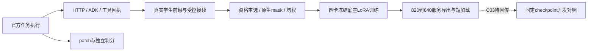

# Gemma Agent Trajectory SFT

**可执行轨迹、可信训练目标与长序列LoRA的工程复盘**  
Documentation and synthetic CPU examples for an evidence-grounded coding-agent SFT project.

[Kaggle同版Notebook](https://www.kaggle.com/code/fjnulinweisong/gemma-agent-trajectory-sft) · [技术总览](docs/technical-overview.zh-CN.md) · [证据与指标](docs/evidence-and-metrics.zh-CN.md) · [技术追问](docs/interview-guide.zh-CN.md) · [发布范围](docs/release-notes.zh-CN.md)

本项目围绕公开仓库issue修复，接入官方SDK、ADK工具与独立判分，将原始HTTP、实际工具动作和回执关联，再把有资格的学生前缀接续整理成原生SFT目标。训练侧组合冻结BF16底座、FP32 LoRA、选择性FSDP2、长序列分块重算及共享K/V服务导出。

本仓库是**文档与教学示例发行**。完整竞赛执行器、真实轨迹/数据和模型权重不在附件中。源证据使用带原行号的脱敏有限摘录；所有“已验证”指标归属于相应既有报告，不是本Notebook新运行的模型结果。

## 四个可解释的技术点

- **执行证据**：HTTP → ADK实际调用/回执 → patch → 独立verification，区分文本伪工具与真实执行。
- **训练资格**：真实学生请求边界、受控教师接续、公开短说明、严格原生token mask和题/阶段均权。
- **长序列训练**：冻结decoder由FSDP2分片，LoRA复制并显式同步，处理共享head、非浮点辅助参数和尾批通信。
- **交付兼容**：native820→serving840的共享K/V适配；精确重复引用回传保留行为证据。

## 规模与结果边界

| 项目 | 有据可查的事实 |
|---|---|
| C03数据 | 990目标回合 / 160任务ID / 199,458正token，最长26,910，无截断 |
| LoRA | 60文本层 / 410投影 / 122,429,440训练参数，标准r16 |
| 历史C02训练 | 524更新、4,180次真实行消费；最长26,979两累积，真实服务短加载通过 |
| C01同温度开发对照 | base T.2=51/129；C01 T.2=48/129；同LoRA T1=52/129但缺匹配base T1 |
| 回传瘦身实例 | 1,706,923,496B→154,622,101B，减少90.94%，HTTP/ADK行为证据保留 |
| 当前未完成 | C03只接到23/124步用户进度；96题次面板待执行/待回传；外部留出与精确resume待完成 |

**没有建立LoRA稳定任务净收益或隐藏泛化结论。** 协议指标改善、训练loss下降、服务加载成功和整题通过是不同证据。C02只有主动中断的部分行为窗口，不能补成129成绩。本项目没有执行GRPO、DPO或在线RL。

## 阅读与本地教学演算

1. 从[技术总览](docs/technical-overview.zh-CN.md)了解架构与取舍。
2. 用[42项证据主张](docs/evidence-and-metrics.zh-CN.md)、[脱敏摘录](docs/source-excerpts.md)和[机器指标](evidence/metrics.json)检查事实边界。
3. 打开[Notebook](notebooks/gemma-agent-trajectory-sft.ipynb)，四个代码单元只用Python标准库演算合成例子，可在本地CPU逐单元运行。

Kaggle发布采用Quick Save，不启动平台计算；Notebook中的代码没有模型、网络请求或训练入口。完整GPU实验不属于此教学复现范围。

## 来源与许可

官方SDK/ADK、Gemma、PyTorch/FSDP2、PEFT和vLLM均归属各自上游。部分内存设计参考公开训练kit，具体来源见[NOTICE](NOTICE.md)。原创说明与新增教学代码采用[MIT](LICENSE)；第三方引用、模型和数据仍遵守各自条款。

证据整理截点：2026-11-16。后续训练与面板结果只在取得实际回传后更新。
