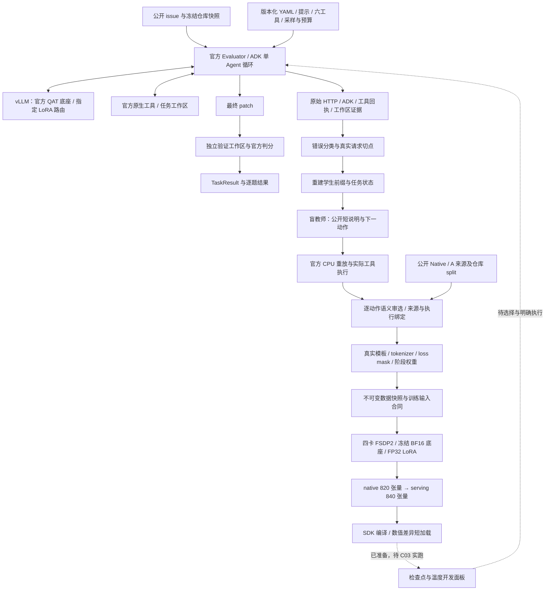

# Gemma 编码 Agent 与轨迹 SFT：技术总览

> 范围：公开技术说明与教学资料。核对日期：2026-11-16。本文依据当前源码及既有执行回传整理，没有新运行模型、训练、评测或教师采集。源证据使用脱敏摘录；本仓库不提供完整竞赛执行环境。

## 1. 项目解决的问题与当前完成度

项目围绕软件仓库 issue 修复，搭建了“官方任务执行与独立判分 → 轨迹取证与错误诊断 → 真实学生状态上的受控教师接续 → 合格目标的原生模板 SFT → 服务导出与行为对照”的工程链路。重点是让模型产生可执行、可验证的源码修改，并把失败变成有来源、有资格的训练目标。

可证实的技术价值集中在三处：保持官方执行与判分语义的可观测运行框架；逐动作资格和逐 token 边界约束的数据生产；在四张 A800 上承载 Gemma 31B 冻结底座、完整长序列的 LoRA 训练与服务兼容。官方 SDK、ADK、vLLM、PEFT、FSDP2 和模型本身均为上游能力，项目贡献是适配、组合、边界处理和验证。

| 组成 | 本次可确认状态 | 不能据此声称 |
|---|---|---|
| 官方任务执行、独立判分、HTTP/ADK 取证 | 历史完整双臂 258 题臂有回传；实际 6,464 动作与 7,031 请求已核绑定 | 隐藏评测环境与本地完全相同 |
| C01/C02 四卡 LoRA 训练、820→840 导出与真实短加载 | 已有目标机训练回传和独立接纳 | 训练成功即任务提分 |
| C03 数据与训练链路 | 990 目标回合、160 任务 ID 已冻结；CPU 合同及发行核验完成 | C03 已完成训练或已达到某线上分数 |
| C03 训练进度 | 用户报告 23/124 步、loss 1.25→0.35；原始训练回传尚未接纳 | 将用户进度转述写成已独立验证的训练曲线 |
| C03 检查点×温度面板 | base/50%/75%/100% × T0.2/T1.0 × 12 题，共 96 题次；交付完成，执行尚未确认 | 96 题次已经运行或已选出最佳 checkpoint |

最新状态取自 [C03 动态规格](source-excerpts.md#s001)、[进度记录](source-excerpts.md#s002)及[面板报告](source-excerpts.md#s003)。早期 README、研究报告中的 NOT_RUN 是当时快照；不能将不同时间的段落拼成当前完成状态。

## 2. 系统架构

图中的教师链属于离线数据生产；正式学生评测不接入教师。判分材料可供离线诊断与资格核实，不能作为下一动作教师的后验答案输入。局部动作有效、整题辅助通过、学生独立通过分别记录。

### 主要模块与技术栈

| 模块 | 主要位置 | 职责与依赖 |
|---|---|---|
| 学生运行 | `runtime/baseline.py`、`runtime/submission.py` | 调用官方 Evaluator、模型 registry 和 sandbox；物化版本化提交 |
| 取证 | `runtime/request_log.py`、`runtime/evidence.py`、`runtime/trace_audit.py` | 被动 HTTP 转发记录、ADK 事件与补丁/验证绑定；本地诊断组件 |
| 学习入口 | `learning_pipeline/__main__.py`、`core.py` | 轮次、审查、作业、数据、训练与评测交接的统一 CLI |
| 教师接续 | `collection/runner.py`、`capture_stage.py`、`equivalence.py` | 请求边界重建、状态比对、盲教师、官方重放及执行绑定 |
| 数据 | `dataset.py`、`composition.py`、`fresh.py`、`native.py` | 资格导入、来源混合、显式派生、原生渲染、mask、均权和审计 |
| 训练 | `training/train_adapter.py`、`train_core.py`、`fsdp_runtime.py` | Transformers / PEFT / PyTorch；冻结底座、长序列 loss、分片与梯度同步 |
| 快照 | `training/schedule.py`、`checkpoint.py` | optimizer-step 调度、native adapter 保存回读、最终状态留存 |
| 服务与交付 | `server/`、`evaluation/`、`templates/stage_compact.py` | 训练输入合同、K/V 导出、SDK/加载检查、安全展开、失败与回传处理 |

已冻结的目标训练栈为 PyTorch 2.10.0+cu128、Transformers 5.13.1、PEFT 0.21.2、Accelerate 1.15.0、compressed-tensors 0.15.0.1、Tokenizers 0.22.2、Safetensors 0.8.0、Jinja2 3.1.6。评测使用 swegemma 0.2.11、adk-submission 0.2.13、adk-eval-core 0.1.0、google-adk 1.36.1 及比赛 vLLM 0.19.1 构建；同一版本号不替代具体 wheel/源码绑定。本地微型测试涉及 Torch 2.14 CPU，与目标 CUDA 栈分开记载。[训练依赖](source-excerpts.md#s004) · [评测依赖](source-excerpts.md#s005)

## 3. 官方任务执行、上下文与取证

### 3.1 让模型解题，独立环境判分

当前研究对象采用一个 `LlmAgent`，通过官方工具读写源码和运行检查，产出 patch 后交独立验证。六工具为 `get_status`、`submit_patch`、`read_file`、`run_command`、`edit_file`、`write_file`；这是本项目选定的接口集合，官方还有其他原生工具，并非平台只有六个。

r04/C03 的冻结口径为每题 480 秒、28 次计费调用、80 轮；命令超时 240 秒，独立验证 300 秒。status/submit 的免费调用应与计费调用分开。采样 top_p=.95、top_k=64，总输出上限 8192、thinking_budget=4096。模型的自然语言提示不能代替官方硬预算；输出预算也不是训练上下文长度。相关参数以[冻结轮次配置](source-excerpts.md#s006)和实际输入 ZIP 为准，不能拿当前活动配置解释旧运行。

本地 runner 直接构造官方 `Evaluator(EvalConfig(...))`，保留官方工具、ADK 主循环、预算与独立判分；观测层保存 Agent 工作区证据，不读验证工作区来替模型修复。[运行接线](source-excerpts.md#s007) · [逐题结果与 patch 保存](source-excerpts.md#s008)

### 3.2 上下文压缩是官方能力，项目核实它怎样生效

配置使用 ADK `EventsCompactionConfig`：interval=15、overlap=2、token_threshold=14336、event_retention_size=5，另有 context cache 配置。项目没有发明另一套在线摘要 Agent 循环；工作是固定配置、捕获摘要请求及后续主请求，检查摘要是否真正送达、哪些原始证据被替代、摘要有没有失真。

C01 双臂报告核到 167/141 个已返回可解析摘要全部进入后续主请求；这能排除该批“摘要普遍漏发”的解释，不能证明摘要始终准确或压缩没有损害。C02 部分评测的 39 个摘要均送达，但存在编辑状态判断失真。判断压缩问题要同时看送达与内容正确性。[压缩接线](source-excerpts.md#s009) · [C01 观察](source-excerpts.md#s010) · [C02 观察](source-excerpts.md#s011)

### 3.3 把“生成了什么”与“执行了什么”关联起来

HTTP recorder 是本地被动 relay，请求 body 原样转发，保存 request、response.raw、metadata；raw 是去除 HTTP 传输 framing 后的实体字节，可包含 SSE，不是模型内部 token 流。取消、失败和未终结响应保留其状态，不补造 usage。ADK 事件记录实际 function call 和 function response，离线 audit 再把 HTTP 参数、ADK、官方 trace、patch 与验证结果关联。

C01 双臂已有 7,031 HTTP 请求与 6,464 工具动作的绑定审查。这个数量是相应运行的审计覆盖，不是并发量、用户量或服务 QPS，也不是全部 reasoning 逐字语义审阅。记录器与离线审计不随评分 ZIP 上线。[HTTP 记录器](source-excerpts.md#s012) · [证据层边界](source-excerpts.md#s013) · [真实覆盖](source-excerpts.md#s014)

### 3.4 先校准评测器，再比较 Agent

项目保留公开 129 题的空补丁/参考补丁控制证据，两个控制条件合计 258 题次。既有视图是 117 题参考可过，其中 2 题空补丁也可过，故 115 题可判别；其余 12 题为已知校准限制。129=115+2+12，不能将控制题或环境限制悄悄从原始官方结果中删除。

新面板复用全量校准绑定，只执行从中选出的 12 个开发题；“完整校准证据已绑定”和“新执行范围为 12 题”分别验证。参考补丁控制证明本地某些环境和裁判条件可用，不能证明隐藏镜像完全相同。[校准口径](source-excerpts.md#s015) · [面板校准与运行范围分离](source-excerpts.md#s016)

## 4. 从失败轨迹到可训练目标

### 4.1 错误分类服务于训练设计

项目把失败拆成调用/编辑表示、行动推进与恢复时机、实现语义与覆盖等类别。标签允许重叠；“已定位未修改”“检查没有击中真实入口”“JSON 合法却执行了破坏性命令”“修复遗漏兼容分支”需要不同目标，不能全部归为工具格式错误。

选择切点时绑定实际学生请求、来源臂、工具回执和当时状态。看到另一温度臂成功，不意味着可以把它的最终 patch 嫁接成当前学生的真实下一步。分析者提出的 rewrite 建议只作为诊断 metadata，不能当成执行前教师输出。[分类边界](source-excerpts.md#s017) · [逐题复盘](source-excerpts.md#s018)

### 4.2 受控教师短接续：先有真实状态，再有新动作

采集按边界逐步重建：从原仓库快照重放已冻结学生动作，捕获官方下一请求与任务文件状态；干净教师只见该请求，生成公开短说明和下一工具动作；再启动独立官方重放，消费该动作并保存真正的工具回执。`target_binding` 是计划，只有 `execution_binding.status=EXECUTED` 且请求/状态比对通过、唯一 ADK 调用与回执对应，才证明实际执行。

教师等待发生在已关闭重放之外，因此离线教师时间、真实重放耗时和原学生时钟分别记录。这不是暂停官方比赛时钟，也不是严格在线 on-policy RL。首次工作区没有原现场观测时标记 RECONSTRUCTED；请求比对允许的路径、时钟和少量展示顺序差异有明确规则，不能把声明等价说成全字节相同。[执行绑定](source-excerpts.md#s019) · [实际教师输入](source-excerpts.md#s020) · [等价范围](source-excerpts.md#s021)

短片段只证明局部动作或有效诊断；没有 TaskResult 时，整体验证为 NOT_RUN。自然闭合链才可记录真正的 resolved，并且官方通过仍不能替代逐动作语义审选。普通安全只读可由主审与机械证据支持；源码写入、验证结论、正说明和边界访问需要明确审核来源。[短片段资格](source-excerpts.md#s022) · [自然闭合资格](source-excerpts.md#s023)

### 4.3 公开说明、模型可见 reasoning 与私人 thinking

教师的 `decision_summary` 是专门撰写的公开训练内容，描述已观察证据及下一动作理由，产生于实际动作执行前；元数据标 `TEACHER_PUBLIC_DECISION_SUMMARY`。项目不请求或记录教师私人思维链。学生响应和公开数据中已有可见说明，也必须按真实来源、整段正确性和已读范围决定资格。

未全文审阅的 reasoning 保持 UNKNOWN/masked，不因为动作正确就自动变成正例。C03 完整 completion 视图中，未合格的“当前说明”会显式移除后重新渲染，避免它虽然不计 loss，却留在输入里泄露当前答案；历史说明的来源处理另外记录。[教师协议](source-excerpts.md#s024) · [完整 completion 约束](source-excerpts.md#s025)

### 4.4 用真实模板和 tokenizer 确定监督边界

一个训练行是“完整真实请求前缀＋一个合格的当前助手回合”，不是一整道题。相邻行可以共享历史，但历史、旧助手回合和工具回执全部 label=-100；只监督本行当前目标。完整输入仍参与因果前向，mask 不代表删除上下文或切断上下文的梯度路径。

`Native` 从冻结 `chat_template.jinja` 和 `tokenizer.json` 渲染 prompt/full，先核文本前缀，再核 token ID 严格前缀，并用字符跨度和 tokenizer offset 确定目标。C03 `complete_example` 要求全部实际工具调用均有资格；action 与说明标签不重叠，并集精确覆盖当前 completion，包含真实工具标记和 handoff。超长行隔离，无静默截断。[原生前缀检查](source-excerpts.md#s026) · [完整目标与分量 mask](source-excerpts.md#s027)

实际处理过的边界问题是公开 A 转换来源在工具回执后预置了 18 字符 thought 入口，而当前模板将其放入 completion。修复按源历史的明确分支重建，仍逐字核原 prefix、completion、IDs 和 token 数；没有通过忽略差异放宽准入。全部 A14 条轨迹的 382 个源目标机械重建通过，其中选中 37 个；这不是 382 个新训练目标，也不是本 SDK 重执行。[修复及边界证据](source-excerpts.md#s028)

### 4.5 当前 C03 数据：规模、暴露与阶段均权

| 来源 | 目标回合 | 任务 ID | 证据边界 |
|---|---:|---:|---|
| 本地 D04 合格目标重选 | 720 | 113 | 复用已有资格；不是原 2090 行再完整训练 |
| 公开 Native | 233 | 41 | 原生捕获来源支持；本轮未在本 SDK 重执行 |
| 公开 A | 37 | 6 | 转换来源支持；严格重建源边界 |
| 合计 | 990 | 160 | 目标回合数不等于独立任务数 |

外部训练部分为 47 个任务 ID、45 个仓库；dev/final 各留出 8 仓库、9 issue，未入训练，环境尚未重建。本地 129 题早已用于开发和训练，不能称盲测。外部审选阅读 85 条轨迹、1,532 个可见回合，205 段保留的非空说明全文核准；这不是整个公开母集全部语义审核。

冻结数据共有 12,199,343 个输入位置、199,458 个正 token，其中行动/边界 156,980、合格说明 42,478；721 行有说明，7 行为事实 final。最长 26,910，上限 32,768；最大当前 completion 为 2,208，无截断。本轮没有新增教师调用。[最终统计与审查](source-excerpts.md#s029)

四阶段为定位 313、编辑 271、验证 195、恢复收尾 211。每题只对实际存在的阶段分配质量，阶段内再分给目标回合：

\[
p_{i,s,j}=\frac{1}{T K_i n_{i,s}},\qquad m_{i,s,j}=N p_{i,s,j}.
\]

其中 T 是任务数，K_i 是题 i 实际保留的阶段数，n_i,s 是该题该阶段目标数。均匀、无放回遍历时用 m 乘行内 CE，平均倍率为 1；不能同时按 p 重采样后再乘同一权重。实际倍率 0.1546875–3.09375。这避免长轨迹或双温度来源自然获得更多任务质量，但阶段分类和配比本身仍是待行为验证的设计。[权重实现](source-excerpts.md#s030)

## 5. 训练工程与服务兼容

### 5.1 从官方 QAT 权重恢复冻结 BF16，只更新 LoRA

训练从原 compressed-tensors QAT 包恢复已存在的权重值：在固定 Transformers 版本使用 `run_compressed=False`，以 BF16 加载，检查 missing/unexpected/mismatched/error，再关闭已恢复模块的 QDQ 包装并冻结底座。没有重新做 NF4 量化，不是 31B 全参训练，也不是重新预训练。[底座加载与冻结](source-excerpts.md#s031)

LoRA 通过 PEFT 注入真实 60 个文本层的 410 个投影，只覆盖 attention 和 MLP，不扩到视觉/音频塔。标准 r16、122,429,440 个可训练参数、820 个 A/B 张量，训练参数保持 FP32；底座和主要计算为 BF16。当前 C03 alpha16、dropout=.05，新 A 随机/新 B 全零，新 AdamW，无 C01/C02 父件。旧 C01/C02 alpha32 是另一个合法配置，不能因后来 alpha16 就追认旧设置非法。[注入与范围检查](source-excerpts.md#s032)

### 5.2 为什么从 DDP 转为选择性 FSDP2

DDP 每卡复制整个底座，增加卡数没有增加单卡容量。历史四卡 DDP 即使保留 MLP 分块，最长样本仍在 RMSNorm 等处 OOM；不能靠缩短样本或删断言完成长序列合同。因此改为只分片 60 个文本 decoder 的冻结浮点权重，`reshard_after_forward=True`，把主要底座存储分摊到四卡。

LoRA 保持原 FP32 `Parameter` 副本，不交给 FSDP 分片；初始化先核各 rank 名称/shape/dtype/顺序，再逐 tensor 从 rank0 广播。每个全局批完成后，按固定顺序、有界 bucket 对 LoRA 梯度 `SUM/world` 一次，并统一有限性检查和裁剪。不能假定 `ignored_params` 会自动同步这些参数。[FSDP2 实现](source-excerpts.md#s033) · [LoRA 梯度归约](source-excerpts.md#s034)

共享 embedding/head 保持复制：selected CE 在不同 rank 按正 token 数调用不同次数的 head，如果将其放入 FSDP collective，可能出现通信次序不一致。无自有参数组的 `TrainingObjective` 作为根，管理 decoder 的前反向钩子；保留共享关系并检查没有完整冻结参数旧引用残留。冻结底座仍要传递梯度到 LoRA，不能将整个 decoder 放进 `no_grad`。

QAT 解压后的模块还可能保留 `weight_shape` 这类 int64 `Parameter`。实现不把它强制转浮点或删除，而是将冻结非浮点状态排除于分片，保持对象、dtype 和数值，浮点 scale 继续分片，并保存分片前参数目录。已有小 CT 生命周期检查和实际 C01/C02 执行支持这一兼容路径；最初现场没有参数名时，不能倒称已锁定具体触发参数。[非浮点状态处理](source-excerpts.md#s035)

### 5.3 长序列：减少中间张量，不删因果上下文

MLP 按 token 维切 512-token 块，仍调用真实 Gemma/PEFT gate/up/down forward，拼回原位置；块内用 non-reentrant checkpoint，保留 RNG，外层 decoder checkpoint 也保留。它针对逐位置独立的 MLP，不将 attention 或训练序列切成互不相关的样本。固定分块的前向/重算随机状态必须一致，但分块与未分块的 dropout 随机分配不承诺逐位一致。[MLP 包装](source-excerpts.md#s036)

训练 attention 按 query 块构造 causal/局部窗口 mask，通过 PyTorch SDPA 和重算处理，避免一次构造整张 L×L attention 矩阵。限制为无 padding 的 batch1 完整文本序列、attention dropout=0，不支持任意 cache/多模态 mask；GQA 的 K/V 有显式展开，因此不能称为通用 FlashAttention 替代或无额外内存开销。[attention 范围](source-excerpts.md#s037)

selected CE 保留完整底座前向，只在有正标签的位置取前一位置 hidden state，按 head chunk=64 计算 vocabulary logits/FP32 CE，并保留模型 softcap。这样避免为所有前缀位置生成全词表 logits；它没有把上下文缩成只剩目标。设计参考了公开训练 kit，项目按当前模型、mask 与梯度合同实现并检查，不能包装为首创。[selected CE](source-excerpts.md#s038) · [来源说明](source-excerpts.md#s039)

### 5.4 全局 batch、尾批与三种 loss

四卡每卡 microbatch1、accum2，global batch=8。真实批集合不变，批内按长度分配至 rank；正常全批训练目标为：

\[
L_{batch}=\frac{1}{8}\sum_{j\in B}m_j\,CE_j.
\]

尾批 6 行按 2/2/1/1 分配，尾批 2 行按 1/1/0/0；仍用约定的分母 8，不补样、不丢样。FSDP 每 rank 需要同样次数的 decoder 通信，空缺 microstep 执行两 token 的零 loss 通信槽，并保存/恢复 RNG；不把空槽算作训练行或实际样本访问。最后小批的优化强度因此小于满批，这是显式保留的归一化约定。[训练归约与日志](source-excerpts.md#s040) · [通信槽](source-excerpts.md#s041)

旧 `action` 只监督合格动作，旧 `joint` 在存在说明的行内按行动 .75/说明 .25 分量均值；C03 `completion` 对整个合格当前 completion 的正 token 求平均，不再套 .75/.25。action/reasoning 诊断不改变梯度目标。C03 说明的实际目标系数为 27.3905%，它不是简单 token 占比，也不是实测梯度贡献。[三种 loss](source-excerpts.md#s042)

### 5.5 native 820→serving 840：架构差异的显式适配

HF Gemma full-attention 层共享 K/V，真实训练只有 410 个投影、820 个 A/B 张量。比赛 vLLM 使用独立 K/V 槽，导出逐个将 native FP32 转为 BF16，并在 10 个 full-attention 层把 K 的 A/B 各复制一份给 V，共增加 20 个张量，成为 840 张量/420 服务投影。新增项不是额外训练参数，也不是合并了两个 adapter。

导出核精确键集合、rank、shape、有限值、原配置 targets、20 个复制项和保存回读，保留 native 原件。随后还需 SDK 编译、真实 adapter 路由和 vLLM 短加载数值差异；文件能打开不能证明服务真正使用了它，短加载差异也不能证明解题能力改善。[导出实现](source-excerpts.md#s043) · [C02 实际接纳](source-excerpts.md#s044)

### 5.6 已经跑通的训练与 C03 待验证内容

C01 实际 498 更新、1990×2 行消费，最长 19,356 两累积通过，训练约 10.30h；C02 实际 524 更新、2090×2 行消费，最长 26,979 两累积通过，loop 13.594h。C02 在指定训练测量阶段 allocated 峰 52.7096GiB，最长检查 reserved 59.45–62.85GiB；这些不是全生命周期总显存峰值，也不能与不同工作量运行直接比较加速比。

C02 训练样本均值 loss .226930→.192685，最终张量有限且发生变化、真实服务短加载通过；部分行为评测仍出现回退。证据说明训练工程和产物有效，不说明配方有效。[C01 实际训练](source-excerpts.md#s045) · [C02 实际训练](source-excerpts.md#s046)

C03 固定一 pass，U=ceil(990/8)=124，W=ceil(.05×124)=7；更新 j≤W 应用 peak×j/W，之后按冻结 horizon 单次 cosine 到 0.1peak，即 1e-5。保存点为 ceil(U/4)、ceil(U/2)、ceil(3U/4)、U，即 31/62/93/124，均为 native FP32。参数来自公开研究与项目诊断的起始方案，尚无本项目 LR/alpha/调度独立消融证明最优。[调度定义](source-excerpts.md#s047)

当前还实现了 final AdamW、各 rank RNG、cursor 与冻结绑定留存，但 `resume_entry_implemented=false`。加载旧 adapter 再新建 AdamW 是新阶段 SFT；不能称为原训练精确断点续跑。[状态留存边界](source-excerpts.md#s048)

## 6. 实验方法与负面复盘

### 6.1 用可比实验回答有限问题

prompt、工具集合、命令时限、会话时限、总输出和思考预算都被探索过；多项同时变化时只能评价整个版本。4096 thinking 与 4096 总输出的组合曾出现纯说明到 length、没有工具动作的响应，支持检查动作空间，不能推出某个新上限必然提分。社区分数只在源码、配置与 adapter 身份可绑定时才可用于对应结论，不将作者最佳分嫁接到公开脚本。

C01 的同提示同温度对照是无 adapter T0.2=51/129，LoRA T0.2=48/129，保持46/新增2/丢5；同 LoRA T1.0=52/129，但缺当前同配置的无 adapter T1 对照。旧 9 工具/420 秒版的 T1=49 不充当这个缺失控制。调用缺必填 107→1、连续重复 81→12 有改善，同时空 patch 11→23，说明协议指标与完整修复目标可能分离。[完整开发对照](source-excerpts.md#s049)

线上 C01 T0.2=.17 有既有 API 完成观测；T1=.15 为最新用户截图观察，本次没有重新 API 核 ID。它们与本地 52/129 是不同指标，不能换算成 Kaggle 分数或声称温度稳定优势。[线上证据范围](source-excerpts.md#s050)

### 6.2 续训退化推动 fresh 方案，但没有唯一根因

C02 从 C01 native 权重精确继承、新建 AdamW，工程训练完成；主动中断的行为窗口只有 T0.2 2/10、T1 1/6，而 C01 同窗分别 4/10、3/6。该窗口是 FastAPI-only、非随机、已暴露开发题，不能外推完整129分数，不能确诊灾难遗忘、LoRA容量不足或某个 LR 必然有错。

fresh C03 同时改变了数据重选、来源、均权、completion 目标、alpha、LR、pass 数和调度，并增加 checkpoint 选择。即使未来表现改善，也只能先归属于这组联合方案；独立因素需要再做固定其余条件的对照。[部分评测限制](source-excerpts.md#s051) · [研究合并限制](source-excerpts.md#s052)

### 6.3 检查点×温度：先保留退路，再选择候选

面板计划用 base、step62、step93、step124，在同 12 题、同顺序、同 prompt/工具/预算下各跑 T.2/T1；每臂从原快照开始。25%权重保留但不在该面板中。观察总解题数之外，还看逐题新增/丢失、空 patch、额度、耗时及必要动作轨迹。

这能在一个训练 horizon 内比较中间权重和末版，但 checkpoint 与固定 GPU 有绑定，单轮也存在采样/负载差异；12 题很小且已暴露。中途 step62 的 cosine LR 历史也不等于另一个独立半程 horizon 训练。面板不证明隐藏泛化、不自动选 final、不自动触发129或提交。[面板设计](source-excerpts.md#s053)

## 7. 交付与失败处理

统一 CLI 组织 `fresh-data → audit-data → freeze → train-package`，并提供 `eval-package`、`checkpoint-panel-package`、`lean-return/restore-return` 等入口。注册、审查、freeze、目标机执行与结果接纳是不同状态，配置/包生成不能提前写成训练或评测完成。[入口](source-excerpts.md#s054)

压缩发行用 manifest 绑定精确成员、大小及原字节，服务器先 CRC 和成员集检查，拒绝路径逃逸、重复/大小写冲突、符号链接/目录联接和不同现有文件；只补缺或复用已相等文件，展开后再次逐流比对。CRC、大小用于完整性辅助，不能代替直接字节相等，也不是数字签名或供应链认证。[安全展开](source-excerpts.md#s055) · [实际部署绑定](source-excerpts.md#s056)

失败保留原始退出码、partial/not_run、源绑定和清理事实，不用外包装 exit0 代替业务结果。曾发生 vLLM IPC 路径 120B 超过 AF_UNIX 107B 限制、两臂启动均零题；修复改用官方 `VLLM_RPC_BASE_PATH` 的短独占目录，先证实零题与清理闭合再继续未执行授权，不拿它当解题失败或无限重试入口。[IPC 修复](source-excerpts.md#s057) · [既有根因记录](source-excerpts.md#s058)

面板四 worker 独立；每卡 T.2 清理闭合后才进入 T1，单卡失败隔离，未闭合自有进程阻止该卡切温和封包。CPU 失败且 GPU 未动可如实 PRESERVED；不伪造恢复证据。这是共享算力上的资源生命周期控制，不是业务容错或跨机器高可用。[worker 与封包检查](source-excerpts.md#s059)

回传瘦身保留全部实际 HTTP/ADK/patch/验证与源码差异，只在 producer 对完整内容直接比较相等后引用不可变输入；嵌套 ZIP 保留成员字节，不宣称恢复原压缩编码。C01 原包 1,706,923,496B → analysis 154,622,101B，减少90.94%，21,093个 HTTP 文件/7,031组和1,030个 ADK/observations 文件保留原字节。它是重复输入消除的实测传输收益，不是通用压缩比。[瘦身结果](source-excerpts.md#s060)

C03 中间 native 权重、optimizer/RNG 默认留服务器；面板 analysis 返回完整行为轨迹，但未返回的中间输入 ZIP 明确标 NOT_RETURNED。没有拿到确切输入就不能声称本地完全恢复或直比中间权重；选中后再取准确候选与温度的输入，或用 full 模式。[面板回传限制](source-excerpts.md#s061)

## 8. 可讲清的贡献与真实短板

适合对外呈现的贡献是执行/评分分离、原始轨迹与实际动作的绑定、学生状态上的受控纠偏与资格合同、原生 token 边界、长序列选择性分片和服务 K/V 适配，以及能复查失败的压缩交付。论文和社区训练 kit 提供动机或实现参考，项目的具体适配和验证范围应逐项说明。[来源与依赖归属](source-excerpts.md#s039)

当前短板也明确：没有稳定、独立的泛化提升结论；本地开发集暴露且外部留出环境未就绪；C02 仅部分行为窗口；C03 训练和检查点对照待回传；缺多 seed 和单因素消融；精确 resume 入口未完成；部分历史资源恢复只有操作回执、缺独立 after 原表。项目已执行的是 SFT 与离线受控采集，没有执行 GRPO、DPO 或在线 RL。

可对外主张逐项见[证据与指标表](evidence-and-metrics.zh-CN.md)，岗位表达见[简历与面试表达](interview-guide.zh-CN.md)，可复制的公开文章骨架见[公开展示方案](release-notes.zh-CN.md)。
